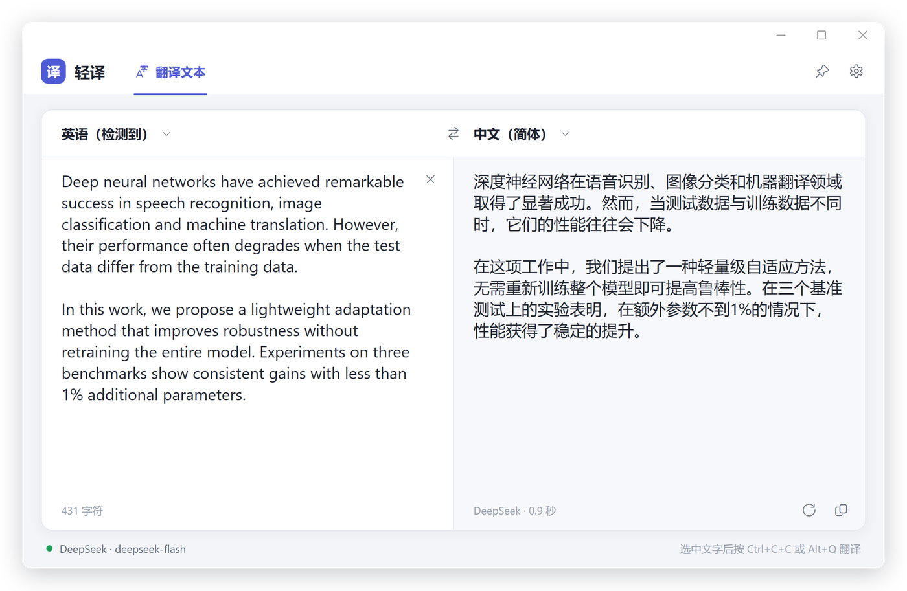
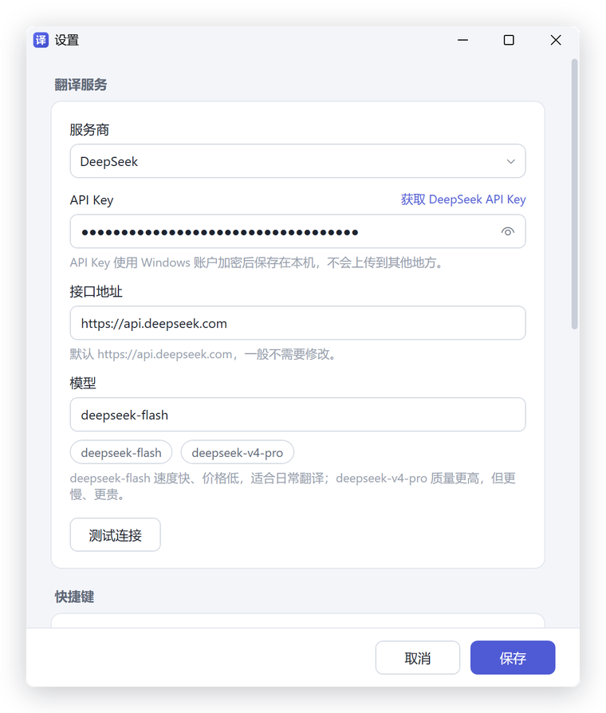
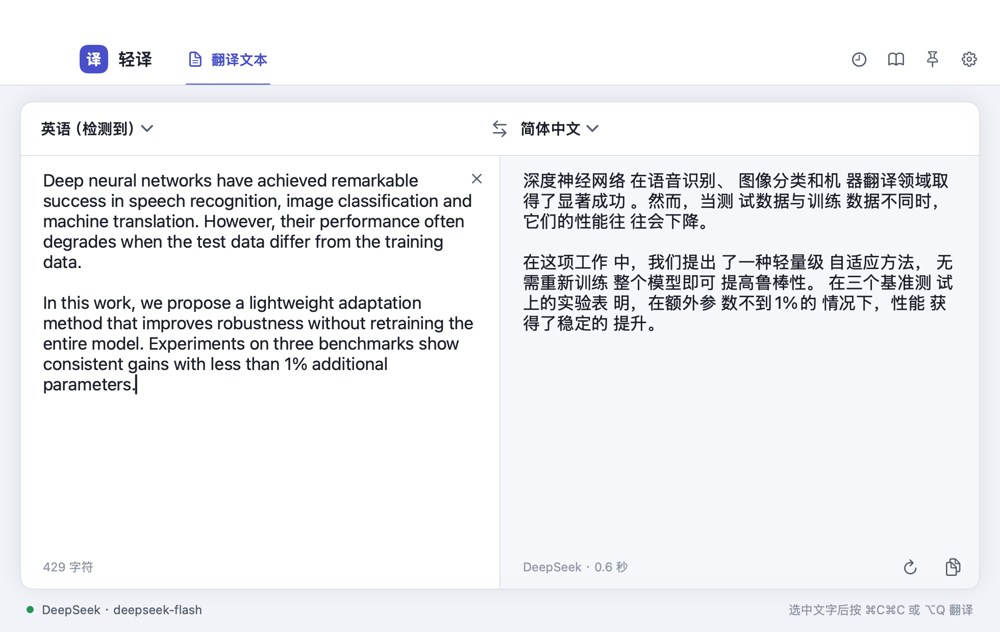

<div align="center">


# 轻译 QingYi Translator

**轻量级 Windows / macOS 翻译工具 · DeepL 平替**

在任意软件里选中文字，按两下 <kbd>Ctrl</kbd>+<kbd>C</kbd>（Mac 上是 <kbd>⌘</kbd>+<kbd>C</kbd>），译文立刻出现。<br>
支持 DeepSeek、通义千问、Kimi、智谱、豆包等 14 家大模型服务和 19 种常用语言，<br>
用自己的 API Key 按量付费，日常翻译一段话通常不到 1 分钱。

[](https://github.com/Jingxuan-WH/QingYi-Translator/releases/latest)


[](LICENSE)

[**⬇️ 下载最新版**](https://github.com/Jingxuan-WH/QingYi-Translator/releases/latest) · [三分钟上手](#-三分钟上手) · [macOS 版](#-macos-版) · [使用说明](#-使用说明) · [文件翻译](#文件翻译) · [支持的服务商](#-支持的服务商) · [常见问题](#-常见问题) · [English](#english)



<sub>截图为 DeepSeek 的真实翻译结果，用时 0.9 秒</sub>

</div>

## ✨ 为什么用轻译

- **熟悉的 DeepL 式界面**：左边原文、右边译文，自动判断翻译方向，译文逐字流式显示，打开就会用。
- **任意软件一键取词**：选中文字后按 <kbd>Ctrl</kbd>+<kbd>C</kbd>+<kbd>C</kbd>（和 DeepL 一样），或按自定义快捷键 <kbd>Alt</kbd>+<kbd>Q</kbd>。只要能用 Ctrl+C 复制文字的地方都能用：浏览器、PDF 阅读器、Office……
- **Windows 和 macOS 都有**：Mac 版是原生 Swift 应用，功能与 Windows 版一致，按 <kbd>⌘</kbd>+<kbd>C</kbd>+<kbd>C</kbd> 或 <kbd>⌥</kbd>+<kbd>Q</kbd> 取词，常驻菜单栏，见[macOS 版](#-macos-版)。
- **14 家大模型服务任选**：DeepSeek、通义千问、Kimi、智谱 GLM、豆包、硅基流动、腾讯混元、百度千帆、MiniMax、OpenAI、Gemini、OpenRouter，还能用 Ollama 在本机离线翻译，或接入任意 OpenAI 兼容接口。
- **19 种常用语言**：简体中文、繁体中文、英、日、韩、法、德、西、葡、意、俄、阿拉伯、越南、泰、印尼、土耳其、荷兰、波兰、印地语。外文默认译成中文，中文自动译成英文。
- **术语表**：指定专业术语、人名、产品名的译法，中英双向生效；可以直接从 Excel 粘贴，也能导入导出 CSV。
- **文件翻译**：整篇翻译 PDF 论文、Word、PPT、Excel、TXT、Markdown 和 SRT 字幕，尽量保持原来的排版。翻译前先识别文档的领域和关键术语，你确认后全文统一按这些译法翻译。见[文件翻译](#文件翻译)。
- **增量翻译**：在已有译文后面再加一段，只翻译新增的部分，前文作为上下文保证术语一致，更快也更省钱。
- **翻译历史**：自动保存最近 100 条，可以搜索，点一下就能恢复原文和译文，不会重复花钱。
- **深色模式**：浅色、深色或跟随系统设置，标题栏也一起变色。
- **中英双语界面**：界面可以切换成 English，适合分享给外国同学和同事。
- **自动更新**：有新版本时提示你，确认后一键下载、校验并安装，不用再手动替换文件。
- **专治 PDF 断行**：从论文 PDF 里复制出来、被硬换行切碎的句子（包括 `trans-lation` 这种断字），会自动拼成通顺的段落再翻译。
- **便宜，没有订阅**：用自己的 API Key 按量付费，没有月费，也没有字数额度。
- **不弄乱剪贴板**：用 Alt+Q 取词时，翻译完会把剪贴板恢复成原来的内容。
- **轻量、免安装**：Windows 版是单个约 8 MB 的 exe（其中大部分是读写 PDF 的组件），Mac 版下载约 2.5 MB，双击就能用；支持开机自启、托盘 / 菜单栏常驻、窗口置顶。
- **注重隐私**：API Key 用 Windows 账户加密（Mac 上存在钥匙串）后保存在本机；要翻译的文字只发给你选择的服务商；没有统计，没有广告。
- **完全开源**：MIT 许可证，代码随便看、随便改。

## 🚀 三分钟上手

### 1. 下载

到 [Releases](https://github.com/Jingxuan-WH/QingYi-Translator/releases/latest) 下载 `Translator.exe`，放进一个固定的文件夹（比如 `D:\Tools\QingYi\`），双击运行，不需要安装。Mac 用户请下载 `QingYiTranslator-mac.zip`，安装步骤见[macOS 版](#-macos-版)。

> [!NOTE]
> 轻译基于 .NET 10。如果电脑上还没有 [.NET 10 桌面运行时](https://dotnet.microsoft.com/download/dotnet/10.0)，第一次打开时会弹窗提示下载，按提示安装 **.NET Desktop Runtime（x64）** 即可，只需装一次。

### 2. 获取 API Key

默认使用 DeepSeek（国内直连、便宜、中英翻译质量好）：

1. 打开 [DeepSeek 开放平台](https://platform.deepseek.com/)，注册并登录。
2. 充值少量余额（几块钱就能用很久）。
3. 在 [API Keys](https://platform.deepseek.com/api_keys) 页面创建一个 Key 并复制。

想用其他服务商？在设置里换一个就行，每家都有“获取 API Key”的直达链接，见[支持的服务商](#-支持的服务商)。

### 3. 填入 Key

第一次启动时会自动弹出设置窗口：粘贴 API Key → 点「测试连接」→ 看到“连接成功”后点「保存」。



完成！去任意软件里选中一段文字，按两下 <kbd>Ctrl</kbd>+<kbd>C</kbd> 试试。

## 🍎 macOS 版

<div align="center">

<br>
<sub>macOS 版主界面；深色模式见 <a href="docs/images/mac-dark.png">这里</a></sub>
</div>

Mac 版是用 Swift 写的原生应用，支持 macOS 13 及以上，Apple 芯片和 Intel 都能用。界面、14 家服务商、术语表、增量翻译、历史、深色模式、中英界面和自动更新与 Windows 版完全一致，只是按键换成了 Mac 的习惯：

| Windows | macOS | 作用 |
|---|---|---|
| <kbd>Ctrl</kbd>+<kbd>C</kbd>+<kbd>C</kbd> | <kbd>⌘</kbd>+<kbd>C</kbd>+<kbd>C</kbd> | 翻译选中的文字 |
| <kbd>Alt</kbd>+<kbd>Q</kbd> | <kbd>⌥</kbd>+<kbd>Q</kbd> | 翻译选中的文字 / 打开或隐藏窗口（可在设置中修改） |
| <kbd>Ctrl</kbd>+<kbd>Enter</kbd> | <kbd>⌘</kbd>+<kbd>↩</kbd> | 立即翻译 / 整体重新翻译 |
| <kbd>Ctrl</kbd>+<kbd>H</kbd> | <kbd>⌘</kbd>+<kbd>Y</kbd> | 打开或关闭翻译历史 |
| <kbd>Ctrl</kbd>+<kbd>O</kbd> | <kbd>⌘</kbd>+<kbd>O</kbd> | 翻译文件 |
| 系统托盘 | 菜单栏的“译”图标 | 点击打开窗口，右键显示菜单 |

### 安装

1. 到 [Releases](https://github.com/Jingxuan-WH/QingYi-Translator/releases/latest) 下载 `QingYiTranslator-mac.zip`，解压后把 `QingYi Translator.app` 拖进“应用程序”文件夹。
2. 第一次打开时，macOS 会提示“无法验证开发者”（程序没有 Apple 开发者签名）：在应用上**右键 → 打开**，再点一次“打开”即可，以后就能正常双击了。如果提示“已损坏”，在终端里运行一次 `xattr -dr com.apple.quarantine "/Applications/QingYi Translator.app"`。
3. 和 Windows 版一样，第一次启动会弹出设置窗口：选服务商、粘贴 API Key、点“测试连接”、保存。

### 取词和权限

- **<kbd>⌘</kbd>+<kbd>C</kbd>+<kbd>C</kbd> 不需要任何权限**：轻译通过剪贴板的变化识别“连续两次复制”，只有同一段文字在半秒内被复制两次才会触发，日常复制不受影响。
- 在“系统设置 › 隐私与安全性 › 辅助功能”里打开轻译后，<kbd>⌘</kbd>+<kbd>C</kbd>+<kbd>C</kbd> 会改为直接监听按键（更准），<kbd>⌥</kbd>+<kbd>Q</kbd> 也能替你复制选中的文字并在翻译后恢复剪贴板。没有这个权限时，<kbd>⌥</kbd>+<kbd>Q</kbd> 只用来打开或隐藏窗口。设置里有一张“辅助功能权限”卡片显示当前状态，并能直接打开系统设置。
- 更新到新版本后，macOS 可能把辅助功能权限视为失效（因为程序没有开发者签名）。如果取词不再起作用，到辅助功能列表里把轻译关掉再打开，或删掉重新添加即可。

### 其他

- 关闭窗口只是收进菜单栏，程序继续在后台等待快捷键；按 <kbd>⌘</kbd>+<kbd>Q</kbd> 或在菜单栏图标上右键选“退出”才会真正退出。
- API Key 保存在 macOS 钥匙串，设置、术语表和历史保存在 `~/Library/Application Support/QingYiTranslator/`。更新到新版本后第一次读取 Key 时，macOS 可能询问是否允许轻译访问钥匙串，点“始终允许”即可。
- 命令行也能用：`"/Applications/QingYi Translator.app/Contents/MacOS/QingYiTranslator" --translate "text"`（可加 `--to ja` 指定目标语言，或从标准输入读入），方便写脚本。
- 从源码构建只需要 Xcode Command Line Tools：`cd mac && ./Scripts/build-app.sh`，生成的应用在 `mac/build/`；单元测试用 `./Scripts/test.sh`。

## 📖 使用说明

### 三种翻译方式

| 方式 | 怎么做 | 说明 |
|---|---|---|
| **Ctrl+C+C** | 选中文字，按住 <kbd>Ctrl</kbd> 连按两下 <kbd>C</kbd> | 和 DeepL 相同。复制是你自己按的，兼容性最好 |
| **快捷键取词** | 选中文字，按 <kbd>Alt</kbd>+<kbd>Q</kbd> | 程序替你复制，翻译完自动恢复剪贴板。没选中文字时直接打开窗口，再按一次隐藏 |
| **直接输入** | 在左侧输入或粘贴 | 停止输入约 0.7 秒后自动翻译，<kbd>Ctrl</kbd>+<kbd>Enter</kbd> 立即整体重新翻译 |

整篇文件的翻译见下面的[文件翻译](#文件翻译)。

### 文件翻译

点主窗口顶部的「翻译文件」（或按 <kbd>Ctrl</kbd>+<kbd>O</kbd>，Mac 上是 <kbd>⌘</kbd>+<kbd>O</kbd>；托盘 / 菜单栏图标的菜单里也有），选择文件，或者直接把文件拖进主窗口。

1. **识别领域和术语**：轻译从文档里挑出标题、摘要、各级标题和分布在全文的若干段落（几千字），只请求一次，让模型判断文档属于什么领域（如“电气工程 · 电力系统”）、是什么文体，并列出关键术语和译法。你的术语表里用得上的条目会一起列出，并且优先。
2. **确认**：领域、文体和每条术语都可以修改、删除或添加，也可以换目标语言；不想等的话点「跳过，直接翻译」，只按术语表翻译。
3. **翻译**：全文分批发给模型（每批几十段，同时发几批），每一批都带上领域、文体和术语要求，保证全文用词一致。公式、代码、网址、编号和引用标记（如 [12]）保持原样。网络出错会自动重试；可以随时取消，之后点「继续翻译」时已经译好的部分不会重复付费。
4. **完成**：译文保存在原文件旁边，命名为 `原文件名.目标语言.扩展名`，比如 `paper.zh-Hans.pdf`、`报告.en.docx`，**原文件不会被修改**，同名文件也不会被覆盖。点「打开译文」或「在资源管理器中显示」（Mac 上是「在访达中显示」）即可。

| 格式 | 版式保留 | 说明 |
|---|---|---|
| **Word**（.docx） | 只替换文字，样式、表格、图片、页眉页脚、脚注尾注、文本框都不动 | 一段里有加粗、斜体、上下标、链接等不同格式时，译文里对应的词保持原来的格式。目录和域在 Word 里“更新域”后才会变成译文；修订会按“全部接受”处理 |
| **PowerPoint**（.pptx） | 只替换文字，版式、动画、图片都不动 | 包括演讲者备注。译文比原文长时，文本框会自动缩小字号，避免溢出 |
| **Excel**（.xlsx） | 只翻译文字单元格 | 数字、日期和公式不动；工作表名、图表和批注不翻译。如果公式按文字内容查找（如 VLOOKUP 一个被翻译的值），可能需要手动调整 |
| **PDF**（文字版） | 译文写回原来的位置，字号自动缩小以放进原来的方框 | 图片、矢量图、表格线、公式都保留；支持双栏论文；参考文献默认不翻译（可以打开）。可以同时生成“双语对照”PDF（原文页和译文页交替）。扫描版 PDF 没有文字层，需要先用 OCR 软件识别 |
| **TXT / Markdown** | 保留段落、空行和 Markdown 语法 | 代码块、行内代码、公式、链接地址不翻译 |
| **SRT 字幕** | 保留序号和时间轴 | 按条翻译，每条字幕的译文仍在原来的时间段里 |

> [!NOTE]
> PDF 本身不记录“段落”，轻译是根据文字的位置、字号推断段落和栏的，复杂的排版（文字绕图、竖排、旋转的页面）可能不够理想。行内的数学公式会保留原来的符号，但字体会换成普通字体。Windows 版会把原文从 PDF 里删掉；Mac 版是用背景色把原文盖住，原文的文字层仍在下面，在译文 PDF 里复制或搜索时可能混入原文。版面要求高的场合，可以对照“双语对照”PDF 阅读，或者先用 Word 打开 PDF、另存为 .docx 再翻译。旧版 .doc / .ppt / .xls 请先在 Office 里另存为新格式。

### 快捷键

| 快捷键 | 作用 |
|---|---|
| <kbd>Ctrl</kbd>+<kbd>C</kbd>+<kbd>C</kbd> | 翻译选中的文字（两次按 C 需在 0.5 秒内） |
| <kbd>Alt</kbd>+<kbd>Q</kbd> | 翻译选中的文字；窗口在前台时按下则隐藏窗口（可在设置中修改） |
| <kbd>Ctrl</kbd>+<kbd>Enter</kbd> | 立即翻译 / 整体重新翻译 |
| <kbd>Ctrl</kbd>+<kbd>H</kbd> | 打开或关闭翻译历史 |
| <kbd>Ctrl</kbd>+<kbd>O</kbd> | 翻译文件（也可以把文件拖进窗口） |
| <kbd>Esc</kbd> | 关闭翻译历史；再按一次隐藏窗口 |

### 语言

- 目标语言默认是**简体中文**：外文会译成中文，中文会自动改为译成英文（和 DeepL 一样）。
- 译文上方的语言框可以换成别的目标语言，比如选“日语”后，中文、英文都会译成日语；原文本来就是日语时，自动改为译成中文。
- 左上角默认「检测语言」，夹着英文术语的中文、简体和繁体都能正确识别；也可以手动指定源语言。
- 中间的 ⇄ 交换方向，译文会变成新的原文，方便回译检查。

### 术语表

点窗口右上角的术语表按钮 📖（或在设置里点「编辑术语表」），填上术语和你想要的译法，比如 `power flow` → `潮流`、`droop control` → `下垂控制`。

- **双向生效**：同一条术语在英译中和中译英时都会用到。两边写成一样（如 `MATLAB` → `MATLAB`）表示保持原样、不翻译。
- **只发送用得上的术语**：每次翻译只把原文里出现的术语交给模型，术语表再大也不会拖慢速度、多花钱。
- **批量添加**：在 Excel 里选中“术语、译法”两列复制，粘贴到任意一行即可一次加入多条；也支持粘贴 `术语 = 译法` 或 `术语 → 译法` 这样的文字。
- **导入导出**：支持 CSV / TSV / TXT，导出的 CSV 可以直接用 Excel 打开，方便备份或分享给同事。
- 右上角的开关可以临时停用术语表；用到术语时，状态栏会显示“用到 N 条术语”。

### 增量翻译

在已有译文的后面继续写或粘贴一段，轻译只把**新增的部分**发给模型，前面几段的原文和译文会作为上下文一起发过去，保证术语和文风前后一致。已经译好的段落原样保留，所以追加内容时更快、也更省钱。

- 修改了中间某一段时，这一段及之后的内容会重新翻译，前面没改的段落照样复用。
- 想让整篇重新翻译一遍（比如追求全文更连贯），点右下角的 ⟳ 或按 <kbd>Ctrl</kbd>+<kbd>Enter</kbd>。
- 不需要的话可以在设置里关闭。

### 翻译历史

点窗口右上角的历史按钮 🕘（或按 <kbd>Ctrl</kbd>+<kbd>H</kbd>）打开翻译历史：

- 自动保存最近 **100 条**，打字过程中的中间结果会合并成一条，不会刷屏。
- 可以搜索原文或译文；点一条就能恢复原文和译文，**不会重新调用接口**，在它后面追加内容也会走增量翻译。
- 鼠标移到某条上可以单独删除，也可以一键清空；不想保存可以在设置里关闭。

### 深色模式与界面语言

在设置最上面的「外观」里：

- **主题**：浅色、深色，或跟随 Windows 的“应用模式”自动切换。
- **界面语言 / Language**：简体中文、English，或跟随系统语言。

选完立刻预览，点「保存」生效，点「取消」恢复原样。

### 自动更新

轻译会在启动时和之后每 12 小时到 GitHub 检查一次新版本。发现新版本时，右上角会出现「新版本」按钮（窗口隐藏时会弹出通知），点开能看到更新内容：

- **立即更新**：自动下载、核对文件的 SHA-256 校验值，替换程序后自动重启，设置和历史都会保留。
- **跳过此版本**：这个版本不再提醒；**以后再说**：下次启动再提醒。
- 也可以在设置里点「检查更新」，或关闭自动检查。只有在你确认后才会下载和安装。

### 托盘与窗口

- 点关闭按钮不会退出，而是缩到系统托盘，快捷键照常可用。
- 左键点托盘图标打开窗口；右键菜单可以翻译文件、打开设置或退出。
- 右上角的 📌 可以让窗口置顶，边读文献边翻译很方便。

### 设置项

| 设置 | 说明 |
|---|---|
| 外观 | 界面语言（简体中文 / English / 跟随系统）和主题（浅色 / 深色 / 跟随系统） |
| 服务商 / 模型 | 14 家服务商任选，每家单独保存 API Key；模型可以点推荐的，也可以手动填写 |
| 附加要求 | 追加给模型的翻译要求，例如“使用学术论文的正式文风；专业术语保留英文原文” |
| 增量翻译 | 追加内容时只翻译新增部分（默认开启） |
| 术语表 | 指定术语的译法，可随时停用 |
| 快捷键 | 可以关闭 Ctrl+C+C，或把 Alt+Q 换成其他组合（需包含 Ctrl、Alt 或 Win）；设置页会提示快捷键是否已被其他程序占用 |
| 常规 | 输入时自动翻译、保存翻译历史、取词后恢复剪贴板、关闭时最小化到托盘、开机自动启动 |
| 更新 | 查看当前版本、手动检查更新、开关自动检查 |

## 🌐 支持的服务商

所有服务商都通过 OpenAI 兼容接口调用。各家“关闭思考”的参数不同，轻译已经按官方文档分别处理好，翻译不会被模型的思考过程拖慢。

| 服务商 | 默认模型 | 说明 |
|---|---|---|
| **DeepSeek** | `deepseek-flash` | 国内直连，便宜，中英翻译质量好（默认） |
| 通义千问（阿里云百炼） | `qwen-flash` | 国内直连；API Key 只能在创建它的地域使用 |
| Kimi（月之暗面） | `kimi-k2.6` | 国内直连 |
| 智谱 GLM | `glm-4.7-flash` | 国内直连，有免费模型 |
| 豆包（火山方舟） | `doubao-seed-2-0-mini-260428` | 国内直连；需要先在控制台开通所用模型 |
| 硅基流动 SiliconFlow | `Qwen/Qwen3-30B-A3B-Instruct-2507` | 国内直连，汇集多家开源模型，部分免费；需要实名认证 |
| 腾讯混元 | `hy3` | 国内直连，通过腾讯云 TokenHub 调用；需要先开通所用模型 |
| 百度千帆（文心） | `ernie-4.5-turbo-32k` | 国内直连；创建 Key 时选择“千帆ModelBuilder” |
| MiniMax | `MiniMax-M3` | 国内直连 |
| OpenAI | `gpt-6-luna` | 需要能访问 OpenAI 的网络环境 |
| Google Gemini | `gemini-3.5-flash-lite` | 需要能访问 Google 服务的网络环境 |
| OpenRouter | `google/gemini-3.5-flash-lite` | 一个 Key 调用多家的模型；需要能访问国外网站 |
| Ollama（本地模型） | `qwen3.5:4b` | 在本机运行，免费、离线、文字不出电脑；不需要 API Key |
| 自定义 | — | 任何兼容 OpenAI 接口格式的服务，填写接口地址和模型名即可 |

> [!TIP]
> 各家的模型更新很快，上表是 2026 年 9 月官方文档里的名称。模型下线或改名时，直接在设置里改成新的模型名即可。如果某个模型不接受轻译发送的可选参数（如 temperature），轻译会自动去掉这些参数重试。

## ❓ 常见问题

<details>
<summary><b>按快捷键没有反应？</b></summary>

- 以**管理员身份**运行的程序里无法取词，这是 Windows 的安全限制。需要的话，可以把轻译也以管理员身份运行。
- 快捷键可能和其他软件冲突，例如 Office 里的 <kbd>Alt</kbd>+<kbd>Q</kbd> 是“告诉我”搜索框。可以在设置里换一个。
- Ctrl+C+C 的两次按 C 需要在 0.5 秒内完成。
</details>

<details>
<summary><b>提示“API Key 无效”“余额不足”或“没有访问权限”？</b></summary>

在设置里点「测试连接」检查。HTTP 401 表示 Key 填错了；402 表示账户余额不足，需要到服务商后台充值；403 或 404 通常是模型还没开通或者模型名不对（豆包、腾讯混元需要先在控制台开通模型）。
</details>

<details>
<summary><b>翻译一次要花多少钱？</b></summary>

以 DeepSeek 为例，按官方[价格](https://api-docs.deepseek.com/quick_start/pricing)计费（以官网为准），日常划词翻译一段话通常不到 1 分钱。开启增量翻译后，追加内容只为新增部分付费。智谱、硅基流动还有免费模型，Ollama 本地模型完全免费。
</details>

<details>
<summary><b>术语表没有生效？</b></summary>

- 确认术语表右上角的开关是开着的，并且原文里确实出现了这个术语（英文不区分大小写，复数也能匹配）。
- 用到术语时，状态栏会显示“用到 N 条术语”；没显示说明原文里没有匹配到。
- 术语表是给模型的强烈建议，极少数情况下模型仍可能按上下文调整说法，可以点 ⟳ 重新翻译。
</details>

<details>
<summary><b>翻译一篇论文要花多少钱、多长时间？</b></summary>

一篇 10 页左右的英文论文大约 5 万个字符，输入和输出合计十几万 token。以 DeepSeek 为例通常只要几毛钱，用时一到几分钟（取决于服务商的速度）。参考文献默认不翻译，能省下不少。Ollama 本地模型免费，但一次只处理一批，会慢一些。
</details>

<details>
<summary><b>PDF 提示“这是扫描版 PDF”？</b></summary>

这通常是扫描版或图片转成的 PDF，里面只有图像，没有文字层。可以先用 OCR 工具（如 Adobe Acrobat、WPS、ABBYY FineReader）识别成文字版 PDF 或 Word，再交给轻译翻译。加了密码保护的文件也需要先去掉密码。
</details>

<details>
<summary><b>怎么更新到新版本？</b></summary>

0.3.0 起内置自动更新：看到右上角的「新版本」按钮，点「立即更新」即可。更早的版本需要手动更新一次：到 [Releases](https://github.com/Jingxuan-WH/QingYi-Translator/releases/latest) 下载新的 `Translator.exe`，右键托盘图标退出轻译后，替换原来的文件即可，设置和历史不受影响。

如果程序放在需要管理员权限才能写入的文件夹（如 `C:\Program Files`），自动更新无法替换文件，会提示你到网页下载。
</details>

<details>
<summary><b>我的文字和 API Key 安全吗？</b></summary>

- API Key 用 Windows DPAPI 加密后保存在 `%APPDATA%\QingYiTranslator\settings.json`，只有你当前的 Windows 账户能解密；Mac 上保存在钥匙串里。
- 要翻译的文字只发送给你选择的翻译服务。轻译没有自己的服务器，不收集任何数据。用 Ollama 本地模型时，文字完全不离开你的电脑。
- 翻译历史和术语表只保存在本机的 `%APPDATA%\QingYiTranslator\` 下（`history.json`、`glossary.json`）。历史可以在设置里关闭，或在历史面板里一键清空。
- 检查更新只访问 GitHub 的公开接口，不发送任何个人信息；下载的新版本会核对 GitHub 提供的 SHA-256 校验值，只接受本项目 Releases 里的文件。
- 为了识别 Ctrl+C+C，程序使用了系统键盘钩子，但只判断 C 键和 Ctrl/Alt/Win 键的状态，不记录任何按键内容，代码见 [`Platform/DoubleCopyHook.cs`](Platform/DoubleCopyHook.cs)。
</details>

<details>
<summary><b>杀毒软件报毒？</b></summary>

程序没有数字签名，又用到了取词所需的键盘钩子和模拟按键，个别杀毒软件可能误报。代码完全开源，你也可以按下文自己编译。
</details>

<details>
<summary><b>怎么卸载？</b></summary>

先在设置里关闭「开机自动启动」，再右键托盘图标退出，然后删除 `Translator.exe` 和 `%APPDATA%\QingYiTranslator` 文件夹即可。
</details>

## 🛠️ 从源码构建

需要 Windows 10/11 和 [.NET 10 SDK](https://dotnet.microsoft.com/download/dotnet/10.0)：

```bash
git clone https://github.com/Jingxuan-WH/QingYi-Translator.git
cd QingYi-Translator
dotnet publish -c Release -r win-x64 --self-contained false -p:PublishSingleFile=true -p:DebugType=None -o publish
```

生成的程序在 `publish/Translator.exe`。单元测试在 `tests/Translator.Tests/`（不包含在程序里）：

```bash
dotnet test tests/Translator.Tests/Translator.Tests.csproj
```

每次提交和 Pull Request 都会在 GitHub Actions 上自动运行 Windows 和 macOS 的测试与构建。

macOS 版需要 macOS 13 及以上和 Xcode Command Line Tools（`xcode-select --install`，自带 Swift 6）：

```bash
cd QingYi-Translator/mac
./Scripts/test.sh          # 单元测试
./Scripts/build-app.sh     # 生成 build/QingYi Translator.app 和 build/QingYiTranslator-mac.zip
```

<details>
<summary>项目结构</summary>

```
├── App.xaml(.cs)              启动、单实例、托盘、快捷键调度、检查更新
├── Core/
│   ├── TranslationClient.cs   OpenAI 兼容接口的流式翻译客户端（SSE）
│   ├── Providers.cs           14 家服务商的预设（接口地址、模型、关闭思考的参数）
│   ├── Glossary.cs            术语表：匹配、导入导出
│   ├── IncrementalCache.cs    增量翻译：复用未改动的段落，只翻译新增部分
│   ├── TranslationHistory.cs  翻译历史（最近 100 条）
│   ├── Languages.cs           19 种语言与离线语言识别
│   ├── UpdateService.cs       从 GitHub Releases 检查、下载并校验新版本
│   ├── Loc.cs                 界面语言（中文 / English）
│   ├── AppSettings.cs         设置读写、API Key 加密（DPAPI）
│   └── FileTranslation/       文件翻译：领域识别、分批翻译、各格式的读写（Office、PDF、TXT/Markdown/SRT）
├── Platform/
│   ├── DoubleCopyHook.cs      Ctrl+C+C 检测（低级键盘钩子，独立线程）
│   ├── GlobalHotkey.cs        全局快捷键（RegisterHotKey）
│   ├── SelectionReader.cs     取词：模拟复制 + 剪贴板备份与恢复
│   ├── SelfUpdater.cs         替换正在运行的程序并重启
│   └── ...                    托盘图标、窗口位置记忆、开机自启等
├── Views/                     主窗口、设置、术语表、文件翻译、更新对话框（WPF）、主题切换
├── Themes/                    界面样式与浅色 / 深色配色
├── tests/Translator.Tests/    Core 的单元测试（xUnit）
└── mac/                       macOS 版（Swift Package，不需要 Xcode 工程）
    ├── Sources/QingYiCore/    与平台无关的核心：服务商预设、流式客户端、术语表、增量翻译、历史、更新检查、文件翻译
    ├── Sources/QingYiTranslator/
    │   ├── App/               启动、窗口、菜单、快捷键调度、更新（AppDelegate.swift）
    │   ├── Platform/          ⌘C⌘C 识别、全局快捷键（Carbon）、取词与剪贴板恢复、菜单栏图标、登录启动、自更新
    │   └── Views/             SwiftUI 界面：主窗口、设置、术语表、文件翻译、更新对话框、配色
    ├── Tests/                 核心逻辑的单元测试（Swift Testing）
    └── Scripts/               build-app.sh（打包）、test.sh、make-icon.swift
```
</details>

## 🗺️ 计划

- [x] 更多服务商预设
- [x] 更多语言
- [x] 翻译历史
- [x] 增量翻译
- [x] 深色模式
- [x] 术语表
- [x] 英文界面
- [x] 自动更新
- [x] macOS 版
- [x] 文件翻译（PDF / Word / PPT / Excel / TXT / Markdown / 字幕）

有问题或建议欢迎提 [Issue](https://github.com/Jingxuan-WH/QingYi-Translator/issues)。如果轻译对你有帮助，请点个 ⭐ Star，让更多人看到它！

## 📄 许可证与声明

- 本项目基于 [MIT 许可证](LICENSE) 开源。
- 文件翻译用到的第三方库：Windows 版用 [PdfPig](https://github.com/UglyToad/PdfPig)（Apache-2.0）读取 PDF、[PDFsharp](https://github.com/empira/PDFsharp) 6.2（MIT）写入 PDF；Mac 版用 [ZIPFoundation](https://github.com/weichsel/ZIPFoundation)（MIT）读写 Office 文件，PDF 用系统自带的 PDFKit。
- 界面设计参考了 DeepL 翻译器。本项目与 DeepL SE 没有任何关联；“DeepL” 是 DeepL SE 的商标，文中提到的其他服务名称均为其所有者的商标。

---

## English

**QingYi (轻译)** is a lightweight translator for Windows and macOS — a DeepL-style alternative powered by large language models.

- **Translate anywhere** — select text in any app and press <kbd>Ctrl</kbd>+<kbd>C</kbd> twice (just like DeepL), or press <kbd>Alt</kbd>+<kbd>Q</kbd>. On a Mac it's <kbd>⌘</kbd>+<kbd>C</kbd> twice or <kbd>⌥</kbd>+<kbd>Q</kbd>.
- **Familiar UI** — a DeepL-like two-pane window with automatic language detection and streaming output.
- **English or Chinese interface, light or dark** — switch under Settings → Appearance, or follow the system.
- **14 providers** — DeepSeek, Qwen, Kimi, Zhipu GLM, Doubao, SiliconFlow, Hunyuan, Qianfan, MiniMax, OpenAI, Gemini, OpenRouter, local models via Ollama, or any OpenAI-compatible endpoint. Each provider's "thinking" switch is set per its docs, so translations stay fast.
- **19 languages** — Chinese (Simplified/Traditional), English, Japanese, Korean, French, German, Spanish, Portuguese, Italian, Russian, Arabic, Vietnamese, Thai, Indonesian, Turkish, Dutch, Polish and Hindi.
- **Glossary** — fix how terms and names are translated, in both directions. Paste two columns from Excel, or import/export CSV. Only terms found in the text are sent to the model.
- **File translation** — translate whole PDF papers, Word, PowerPoint, Excel, TXT, Markdown and SRT files while keeping their layout. The model first identifies the document's field, style and key terms; you review them, and the whole file is translated consistently. See below.
- **Incremental translation** — append a paragraph and only the new part is sent, with the earlier paragraphs as context for consistent terminology.
- **History** — the last 100 translations, searchable; restoring one costs nothing.
- **Built-in updates** — you're told when a new version is out; one click downloads it, checks its SHA-256 digest and restarts.
- **Fixes PDF line breaks** — sentences broken across lines (and hyphenated words) are joined before translation.
- **Small and portable** — a single ~8 MB exe on Windows (mostly the PDF components; needs the [.NET 10 Desktop Runtime](https://dotnet.microsoft.com/download/dotnet/10.0)) or a ~2.5 MB download for the native Swift app on macOS 13+, with tray / menu bar icon, autostart and always-on-top.
- **Private** — your API keys are encrypted with Windows DPAPI (stored in the Keychain on macOS); text goes only to the provider you choose.

**Quick start:** download `Translator.exe` (Windows) or `QingYiTranslator-mac.zip` (macOS) from [Releases](https://github.com/Jingxuan-WH/QingYi-Translator/releases/latest) and run it. On macOS, unzip, drag the app to Applications and use right-click → Open the first time (the app isn't notarized). If your system language isn't Chinese, the interface starts in English (change it under Settings → Appearance). Pick a provider, paste its API key, click **Test connection**, then **Save**.

**macOS notes:** <kbd>⌘</kbd>+<kbd>C</kbd>+<kbd>C</kbd> works without any permission (it watches the clipboard for a double copy). Granting Accessibility access under System Settings → Privacy & Security lets the app watch the keys directly and lets <kbd>⌥</kbd>+<kbd>Q</kbd> copy the selection for you. Closing the window keeps the app in the menu bar; quit with <kbd>⌘</kbd>+<kbd>Q</kbd>. There is also a command-line mode: `QingYiTranslator --translate "text" [--to ja]`.

**File translation:** click **Translate files** at the top of the main window (<kbd>Ctrl</kbd>+<kbd>O</kbd> / <kbd>⌘</kbd>+<kbd>O</kbd>, also in the tray / menu bar menu), or drop a file on the window. The app sends a sample of the document (title, abstract, headings, a few paragraphs) once to identify the field (e.g. "Electrical Engineering · Power Systems"), style and key terms, merged with your glossary (your entries win). Edit them or skip the step, then the file is translated in batches with automatic retries; you can cancel and continue later without paying twice. The result is saved next to the original as `name.<language>.ext` (e.g. `paper.zh-Hans.pdf`); the original is never changed.

- **Word / PowerPoint / Excel** — only the text is replaced; styles, tables, images, headers/footers, footnotes, text boxes and formulas stay. Mixed formatting inside a paragraph (bold, italics, links…) follows the translated words. PowerPoint text boxes shrink the font when the translation is longer. Excel translates text cells only, not formulas or sheet names.
- **PDF (with real text)** — the translation is written into the original text boxes, shrinking the font to fit; images, vector graphics, table lines and display formulas stay; two-column papers work; the reference list is skipped by default. Optionally also creates a bilingual PDF with original and translated pages alternating. Scanned PDFs need OCR first. Complex layouts (text wrapped around figures, rotated pages) may not come out perfectly. On macOS the original text is covered rather than removed, so copying or searching the translated PDF may pick it up too.
- **TXT / Markdown / SRT** — Markdown syntax, code blocks and links are kept; subtitles keep their numbers and timings.

**Build from source:** install the .NET 10 SDK and run the `dotnet publish` command shown above (Windows; unit tests: `dotnet test tests/Translator.Tests/Translator.Tests.csproj`), or run `cd mac && ./Scripts/build-app.sh` with the Xcode Command Line Tools (macOS; tests: `./Scripts/test.sh`).

Licensed under MIT. File translation uses PdfPig (Apache-2.0) and PDFsharp 6.2 (MIT) on Windows, and ZIPFoundation (MIT) plus the system PDFKit on macOS. Not affiliated with DeepL SE.
